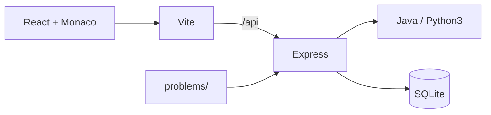

# JustCode

**English** · [繁體中文](READMEzhTW.md)

JustCode is a coding practice app for one person on one computer. Pick a problem, write a Java or Python solution in your browser, and get feedback from local tests. You can close the app, come back to your draft, and review the exact code you submitted. No account is required.

[Quick start](#quick-start) · [Your first solution](#your-first-solution) · [Practice history](#practice-history) · [Add problems and tests](#add-problems-and-tests) · [Back up your work](#back-up-your-work) · [Developer guide](#developer-guide)

## Quick start

### 1. Install the tools

Install Node.js and **one** of the two languages below. SQLite and the browser editor come with the app. Open Terminal on macOS/Linux or PowerShell on Windows to check your installation.

| To do this | Install | Check in your terminal |
| --- | --- | --- |
| Start JustCode | Node.js 22 or newer with npm. [Download Node.js](https://nodejs.org/en/download) | `node --version` and `npm --version` |
| Solve in Python | Python 3.9 or newer with a `python3` command, including on Windows. [Download Python](https://www.python.org/downloads/) | `python3 --version` |
| Solve in Java | JDK 11 or newer, which includes the compiler and runtime. [Download a JDK](https://adoptium.net/temurin/releases/) | `javac --version` and `java --version` |

If you already use Docker, you can run Java or Python in a container. The images and startup commands are under [execution modes](#technical-reference).

### 2. Get the project and install dependencies

If you have Git, run the following commands. You can also choose **Code → Download ZIP** on GitHub, extract it, and open a terminal in the folder containing `package.json`. Run the remaining commands from that folder.

```bash
git clone https://github.com/TsengPinRuei/JustCode.git
cd JustCode
```

**macOS or Linux**

```bash
npm ci
```

**Windows PowerShell**

Use an up-to-date Node.js 22.x release and the npm command below to match the Windows checks and install the bundled SQLite driver.

```powershell
npx --yes npm@11.20.0 ci
```

### 3. Open the app

```bash
npm run dev
```

Leave the terminal running and open the **Local** URL printed by Vite, usually [http://localhost:5173](http://localhost:5173). You should see **Problems** with two bundled exercises on a fresh install. Use a desktop browser window of at least 1200 × 720 for the full workspace. Once dependencies are installed, you can practice the bundled problems offline.

When you finish, let saves and submissions complete, then press `Ctrl+C` in the terminal. Next time, run `npm run dev` again.

## Your first solution

Open **-27. Add Two Integers**. For the first example, the inputs are `12` and `5`, so your method should return `17`. In **Language**, choose **Python3** or **Java** and replace the editor contents with the matching solution. JustCode calls `Solution.sum` for you and checks the value you `return`.

**Python3**

```python
class Solution:
    def sum(self, num1: int, num2: int) -> int:
        return num1 + num2
```

**Java**

```java
class Solution {
    public int sum(int num1, int num2) {
        return num1 + num2;
    }
}
```

1. Under **Testcase**, select **Case 1** and click **Run**. A test case pairs an input with its expected answer. **Result** should show **Accepted** and **2 / 2** because Run checks every visible case.
2. Click **Submit**. With the bundled tests, the result should be **Accepted**, **52 / 52**. The problem now has a ✓ in **Problems**.
3. Click **Submission history** on the problem, then **View** to see the code and result you just saved.

Both bundled problems have starter code and an **Editorial** tab with worked solutions.

| Problem | Difficulty | Visible / hidden tests | Editorial |
| --- | --- | --- | --- |
| [-27. Add Two Integers](problems/add-two-integers/problem.json) | Easy | 2 / 50 | [Addition and a bitwise approach](problems/add-two-integers/editorial.md) |
| [-09. Sort an Array](problems/sort-array/problem.json) | Medium | 3 / 69 | [Five sorting algorithms and their trade-offs](problems/sort-array/editorial.md) |

## Everyday practice

| What you want to do | Action | What to look for |
| --- | --- | --- |
| Check the visible examples | Select any **Case** under **Testcase** and click **Run**. | Compare **Expected** with **Actual** for each case. |
| Try your own input | Select **Custom Input**, enter `{"num1": -3, "num2": 8}` for the addition problem, and click **Run**. | Look for `5` under **Actual**. Here **Accepted** means the code ran successfully. You check the answer yourself. |
| Record an attempt | Click **Submit** to run the visible and local hidden tests. | JustCode saves the submitted code even when a test fails. A passing submission marks the problem solved. |

The editor saves your draft about one second after you stop typing. Each problem keeps separate Java and Python drafts. **Reset** immediately replaces the current language's draft with its starter code. You can also resize the panes, change the editor font size, and copy code from the editorial.

If a test fails, **Wrong Answer** points to a return value that differs from the expected answer. **Compile Error** covers Java compilation and Python syntax errors. For **Runtime Error**, read the error details. For **Time Limit Exceeded**, check loops and the amount of work per input. **Console Output** shows debug text from failing visible cases. For hidden cases, the result includes totals and at most the first failure's case number, status, and time.

### Practice history

Open **Activity** to see the last 30 calendar days in your browser's time zone. Filter by **Problem ID**, **Language**, or dates, then click **Apply filters**. Clear both date fields and apply to see all time. Daily and period totals show submissions, accepted submissions, distinct problems practiced, and distinct problems solved. Only **Submit** creates a history entry and counts toward these totals once the backend admits the request.

Use **View** to inspect a submission or copy its code. Open **Stats** on a problem to compare your accepted attempts. **Current** measures elapsed time since opening the problem or your last accepted submission, including idle time. **Best Total** is your shortest recorded time to solve it. **Latest Submit** and **Latest Rank** use browser request time, which includes compilation, process startup and the round trip to the backend. **Server judge** in the submission details measures judging separately.

## Add problems and tests

### Import a LeetCode problem

In **Problems → Import from LeetCode**, paste a public URL such as `https://leetcode.com/problems/two-sum/` and click **Import**. The importer saves the statement, constraints, available Java/Python3 templates and public examples. The examples become visible tests. The hidden-test file starts empty, so an accepted submission initially covers only those examples. LeetCode's private judge tests and official editorials stay on LeetCode. You can add your own hidden tests and editorial.

Imports require internet access. JustCode rejects an existing problem ID with HTTP 409. Choose problems with a single method on `Solution` that returns a JSON-compatible value. Design-class problems, custom node types such as `TreeNode`, and tasks judged solely by in-place changes are outside the runners' current scope.

### Add hidden tests

On the problem, **Download Description** saves a Markdown brief with the parameters and an example test. Prepare a non-empty JSON array and check the expected answers. For **Sort an Array**, this case checks duplicates and a negative number.

```json
[
  {"input": {"nums": [3, -1, 3]}, "output": [-1, 3, 3]}
]
```

Open **Add Hidden Tests**. Choose **Append** to keep existing cases or **Replace** to overwrite the hidden set. Under **Paste JSON**, paste the array or use **Choose File**. **Project Path** reads an existing file relative to the project folder. Click **Import Hidden Tests**, then **Submit** to judge against the updated set. Existing submission results describe the tests used at the time.

<details>
<summary>Author a problem directly in the repository</summary>

1. Copy the [bundled addition folder](problems/add-two-integers/) to `problems/my-addition/`. Omit the legacy `progress.json` from your copy.
2. In `problem.json`, set `id` to `my-addition` and give the problem a title. The ID must match the folder name, start with a lowercase letter or digit, and contain only lowercase letters, digits, hyphens or underscores (up to 200 characters). Keep `functionName`, `params` and `returnType` in sync with the displayed signatures and each language's `template.java` or `template.py`.
3. Put at least one case in `testcases_visible.json`. Each `input` object must use exactly the parameter names, and each `output` is the expected return value. The examples in `problem.json` are for display. Add `testcases_hidden.json` and `editorial.md` as needed.
4. Refresh **Problems**, open the new problem, and check it with **Run** and **Submit**. The backend logs skipped folders when metadata or visible tests are invalid.

</details>

## Back up your work

| Where it lives | What it contains |
| --- | --- |
| `problems/<id>/` | Statements, templates, editorials, and visible and hidden tests |
| `data/justcode.sqlite` | Language drafts, selected language, solve status, submitted code and results |

1. After the app has started successfully at least once, let pending saves and submissions finish. From the project root, run `npm run data:backup`. It prints the path of a consistent SQLite snapshot in `data/backups/` and works while the backend is running.
2. Copy the snapshot **and the matching `problems/` folder** to your backup location. Keep the catalog unchanged during the copy. Git ignores `data/` and problems you add locally.
3. To restore, stop the backend and move the current `data/` and `problems/` folders aside together. Restore the saved catalog to `problems/`, create a fresh `data/`, and copy the snapshot into it as `justcode.sqlite`. Restart and check a draft and its submission history.

**Upgrading from JSON progress files.** On first migration, the backend copies legacy `progress.json` files into `data/backups/legacy-*/` and imports them in one transaction. A malformed file stops migration and the error identifies it. **Imported** history entries represent the accepted summaries older versions saved. Source code for those submissions was never recorded.

Deleting a non-bundled problem from **Problems** removes its folder, drafts and submission history. Back it up first if you need them. If a submission is running for that problem, let it finish before deleting. The two bundled problems are protected.

## Developer guide

### Follow a submission through the code



One Express backend owns the practice database and listens on `127.0.0.1:3000`. On `POST /api/submit`, it loads the problem's tests and saves the submitted code before judging. The runner calls the solution in a temporary directory and compares return values. The backend commits the result and solve status together. After a restart, unfinished submissions appear as **Interrupted**.

| If you are changing… | Start here |
| --- | --- |
| Editor behavior or draft saving | [Problem workspace](frontend/src/pages/ProblemDetail.tsx) · [Save ordering and retries](frontend/src/services/progressPersistence.ts) |
| Import, problem files or validation | [LeetCode importer](backend/src/services/leetcodeService.ts) · [Problem service](backend/src/services/problemService.ts) · [Validation](backend/src/services/problemValidation.ts) |
| How a solution runs or is judged | [Java runner](backend/src/services/javaExecutor.ts) · [Python runner](backend/src/services/pythonExecutor.ts) · [Result comparison and hidden data](backend/src/services/executionUtils.ts) |
| History, migration or daily statistics | [Activity page](frontend/src/pages/Activity.tsx) · [Database](backend/src/services/practiceDatabase.ts) · [Schema and backups](backend/src/services/practiceSchema.ts) · [Activity queries](backend/src/services/activityQueries.ts) |
| Browser/API integration | [API client](frontend/src/services/apiClient.ts) · [Express routes](backend/src/routes/problemRoutes.ts) · [Submission and activity types](backend/src/shared/activity.ts) |

### Build and test

Run these commands from the project root. For the full test suite, install both local language runtimes. Some executor tests skip when a runtime is missing.

| Task | Command |
| --- | --- |
| Check TypeScript, run regression tests, and build | `npm run typecheck`, `npm test`, `npm run build` |
| Run browser tests, including a real Python submission | `npx playwright install chromium` once, then `npm run test:ui` |
| Run one development server | `npm run dev:frontend` or `npm run dev:backend` |
| Preview a build locally | After `npm run build`, run `npm run start:backend` in one terminal and `npm run preview --workspace=frontend` in another. Open Vite's printed URL, usually `http://localhost:4173`. |
| Use the macOS/Linux helper scripts | `./install.sh` checks Node.js and runs `npm install`. `./uninstall.sh` asks before cleaning installed and generated files. |
| Clean dependencies, builds and temporary files | `npm run clean`. The catalog and practice database are kept. |

CI runs type checks, the regression suite, builds, and Chromium tests on Linux with Node.js 22, JDK 17 and Python 3.11. A separate job exercises SQLite storage on Linux, macOS and Windows. Import tests use fixtures and mocked responses, and sandbox tests cover Docker command construction and cleanup with a mocked process. [CI workflow](.github/workflows/verify.yml) · [Test suites](tests/) · [All npm scripts](package.json)

### Technical reference

<details>
<summary>Execution modes, configuration and limits</summary>

Set environment variables in the terminal before starting the backend. `JUSTCODE_SANDBOX_MODE` defaults to `auto`. It selects Docker when the daemon and the configured language image are available, and otherwise uses the host runtime. In `local` mode, solutions run with your operating-system user's file access. Set `docker` to require containers for every run. Containers have networking disabled, a read-only root filesystem and a mount for the execution workspace.

Start Docker and pull the images for the languages you need. Then start the app with the mode set.

```bash
docker pull eclipse-temurin:17-jdk
docker pull python:3.11-slim
```

- On macOS/Linux, run `JUSTCODE_SANDBOX_MODE=docker npm run dev`.
- In PowerShell, set `$env:JUSTCODE_SANDBOX_MODE = "docker"`, then run `npm run dev`.

| Setting | Default |
| --- | --- |
| `PORT` | `3000` on loopback. If changed, update the `/api` target in the [Vite config](frontend/vite.config.ts). |
| `JUSTCODE_JAVA_SANDBOX_IMAGE` / `JUSTCODE_PYTHON_SANDBOX_IMAGE` | `eclipse-temurin:17-jdk` / `python:3.11-slim` |
| `JUSTCODE_DOCKER_MEMORY` / `JUSTCODE_DOCKER_CPUS` / `JUSTCODE_DOCKER_PIDS_LIMIT` | `256m` / `1` / `64` |
| Compilation or Python syntax check / each test / shared execution budget | 10 s / 1 s / 60 s. The browser allows 75 s for the initial request. |
| Concurrent executions | Two Run/Submit requests combined. Additional requests receive HTTP 429. |
| Output / request body / project file | 10 MiB combined stdout and stderr per process, 10 MiB per JSON request, 64 MiB per local data file. |

If Docker cleanup fails, the backend reports the container name and keeps the execution directory until cleanup succeeds. [Execution limits](backend/src/constants.ts) · [Sandbox runner](backend/src/services/sandboxRunner.ts) · [Local access and request limits](backend/src/app.ts)

</details>

<details>
<summary>Local HTTP API and submission retries</summary>

| Purpose | Endpoints |
| --- | --- |
| Health and catalog | `GET /health`, `GET /api/problems`, `GET /api/problems/:id` |
| Judge | `POST /api/run`, `POST /api/submit` |
| Change the catalog | `POST /api/import-problem`, `POST /api/problems/:id/hidden-testcases`, `DELETE /api/problems/:id` |
| Progress and drafts | `GET /api/progress` (add `?view=status` for the list), `GET /api/progress/:id`, `PUT /api/progress/:id` |
| Submission history and timing | `GET /api/submissions`, `GET /api/submissions/:id`, `PATCH /api/submissions/:id/timing` |
| Daily and period totals | `GET /api/stats/daily` |

For a retryable Submit, send a new UUID as `submissionId`. Retrying the same problem, language and code with that ID returns the stored outcome, or HTTP 202 while judging. Changing the payload under that ID returns 409. When the ID is omitted, the server generates one. Only Submit can assign a solved status.

History and daily stats accept `problemId`, `language`, inclusive `from` and `to` dates, and an IANA `timezone` (default `UTC`). History also accepts `page` (starts at 1) and `limit` (default 50, maximum 100).

</details>

<details>
<summary>How the judge compares values</summary>

The judge compares JSON return values. Array order matters, object key order is ignored, and floating-point values use exact comparison. Tasks with multiple valid outputs need an expected value compatible with these rules. The sorting exercise specifies an algorithmic complexity. The judge checks outputs and execution time.

Integer tokens stay exact across disk and HTTP, including values beyond JavaScript's safe integer range. API clients handling large integers need a lossless JSON parser. Java `int` and `long` use signed 32- and 64-bit ranges. Python integers can exceed both within the execution and data limits. Metadata `float` is an alias for finite `double`, including `float[]` → Java `double[]`. Supported boxed list elements can be `null`. Primitive array elements require values. [Numeric validation](backend/src/services/numericContract.ts) · [JSON handling](backend/src/shared/json.ts)

</details>

## Troubleshooting

| If you see this | Try this |
| --- | --- |
| The app opens but cannot load problems | Open the [backend health check](http://localhost:3000/health) and look for `"status":"ok"`. If it fails, check the backend terminal. If it succeeds, check the Vite proxy and use the frontend URL printed at startup. |
| Java or Python fails to start | Run the version checks in Quick start from the same terminal. Java needs both `javac` and `java`. Python needs `python3`. In Docker mode, check `docker info` and the image for that language, then restart the backend after changing either. |
| **Changes have not been saved** | Keep the tab open and copy your code. Reconnect the backend and click **Retry save**. Unsaved edits are held in that tab's memory. |
| Submit loses its connection | Check **Submission history** or use **Retry submission** when offered. The retry reuses the original submission ID. |
| A custom input or hidden test is rejected | Match every parameter name and use valid JSON. Custom Input takes one object. Hidden tests take an array of input/output pairs. For **Project Path**, choose an existing file inside the project. |

## License

Copyright © 2026 Pin Ruei Tseng. The source and bundled materials use the MIT License. Dependencies and imported content keep their respective licenses and terms. [MIT License](LICENSE)
