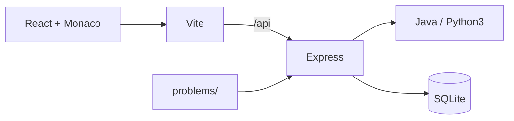

# JustCode

[English](README.md) · **繁體中文**

JustCode 是在自己電腦上練習寫程式的工具。你可以在瀏覽器選題、用 Java 或 Python 解題，再用本機測資檢查答案。下次開啟時可以接著寫草稿，也能回看每次提交的程式碼與結果。使用時無須註冊帳號。

[快速開始](#快速開始) · [完成第一道題目](#完成第一道題目) · [練習紀錄](#練習紀錄) · [新增題目與測資](#新增題目與測資) · [備份與還原](#備份與還原) · [開發指南](#開發指南)

## 快速開始

### 1. 安裝工具

先安裝 Node.js，再從 Python 和 Java 選一種練習。安裝專案套件時會一併裝好 SQLite 與網頁編輯器。macOS／Linux 請開啟終端機，Windows 請開啟 PowerShell，執行下表的指令確認版本。

| 你的用途 | 需要安裝 | 確認版本 |
| --- | --- | --- |
| 啟動 JustCode | Node.js 22 以上，含 npm。[下載 Node.js](https://nodejs.org/en/download) | `node --version` 和 `npm --version` |
| 用 Python 解題 | Python 3.9 以上。Windows 也需要能執行 `python3`。[下載 Python](https://www.python.org/downloads/) | `python3 --version` |
| 用 Java 解題 | JDK 11 以上，內含編譯器與執行環境。[下載 JDK](https://adoptium.net/temurin/releases/) | `javac --version` 和 `java --version` |

如果平常使用 Docker，也可以用容器執行 Java 或 Python。所需映像檔與啟動指令請見[執行模式與設定](#技術參考)。

### 2. 下載專案並安裝套件

如果已有 Git，請執行下列指令。也可以在 GitHub 選 **Code → Download ZIP**，解壓縮後，在含有 `package.json` 的資料夾開啟終端機。後續指令都在這個資料夾執行。

```bash
git clone https://github.com/TsengPinRuei/JustCode.git
cd JustCode
```

**macOS 或 Linux**

```bash
npm ci
```

**Windows PowerShell**

若要使用與 Windows 自動測試相同的環境，請選用已更新的 Node.js 22.x，再執行下列 npm 指令安裝隨套件提供的 SQLite 驅動程式。

```powershell
npx --yes npm@11.20.0 ci
```

### 3. 開啟應用程式

```bash
npm run dev
```

讓終端機保持執行，並在瀏覽器開啟 Vite 顯示的 **Local** 網址，通常是 [http://localhost:5173](http://localhost:5173)。首次安裝會在 **Problems** 看到兩道內建題目。建議使用至少 1200 × 720 的桌面瀏覽器視窗，方便同時閱讀題目、編輯程式與查看結果。裝好套件後，內建題目可以離線練習。

結束時，等草稿儲存、提交完成，再回到終端機按 `Ctrl+C`。下次只需在同一個資料夾執行 `npm run dev`。

## 完成第一道題目

開啟 **-27. Add Two Integers**。第一組範例的輸入是 `12` 和 `5`，所以你的方法應該回傳 `17`。在 **Language** 選 **Python3** 或 **Java**，把編輯器內容換成對應的程式碼。JustCode 會替你呼叫 `Solution.sum`，檢查你用 `return` 回傳的值。

**Python3**

```python
class Solution:
    def sum(self, num1: int, num2: int) -> int:
        return num1 + num2
```

**Java**

```java
class Solution {
    public int sum(int num1, int num2) {
        return num1 + num2;
    }
}
```

1. 在 **Testcase** 選 **Case 1**，按 **Run**。一筆測資包含一組輸入與預期答案。Run 會檢查所有可見測資，所以 **Result** 應顯示 **Accepted** 和 **2 / 2**。
2. 按 **Submit**。使用隨附測資時，應看到 **Accepted** 和 **52 / 52**。題目在 **Problems** 清單中也會標上 ✓。
3. 在題目頁點 **Submission history**，再點 **View**，即可看到剛才提交的程式碼與結果。

兩道內建題目都有起始範本，**Editorial** 分頁則提供解法與程式碼。

| 題目 | 難度 | 可見／隱藏測資 | 題解 |
| --- | --- | --- | --- |
| [-27. Add Two Integers](problems/add-two-integers/problem.json) | Easy（簡單） | 2 / 50 | [加法與位元運算解法](problems/add-two-integers/editorial.md) |
| [-09. Sort an Array](problems/sort-array/problem.json) | Medium（中等） | 3 / 69 | [五種排序演算法及其取捨](problems/sort-array/editorial.md) |

## 日常練習

| 你想做的事 | 操作 | 如何看結果 |
| --- | --- | --- |
| 檢查可見測資 | 在 **Testcase** 選任一個 **Case**，按 **Run**。 | 可逐筆比對預期答案 **Expected** 和實際回傳值 **Actual**。 |
| 試一組自己的輸入 | 選 **Custom Input**。在加法題輸入 `{"num1": -3, "num2": 8}`，按 **Run**。 | **Actual** 應是 `5`。這裡的 **Accepted** 表示程式順利執行，答案是否正確由你確認。 |
| 記錄一次解題嘗試 | 按 **Submit**，執行可見測資與本機隱藏測資。 | 判題系統受理後就會留下紀錄，答錯也查得到。全部通過後，題目會標記為已解出。 |

停止輸入約一秒後，編輯器會自動儲存。同一道題的 Java 與 Python 草稿各自保存。**Reset** 會立即用起始範本覆蓋目前語言的草稿。你也可以拖曳分隔線調整面板、調整字級，或從題解複製程式碼。

遇到 **Wrong Answer** 時，先比對回傳值和預期答案。**Compile Error** 包含 Java 編譯錯誤與 Python 語法錯誤。遇到 **Runtime Error** 可查看錯誤訊息，**Time Limit Exceeded** 則可先檢查迴圈與每組輸入的運算量。失敗的可見測資會在 **Console Output** 顯示除錯輸出。隱藏測資只顯示統計，以及至多第一筆失敗測資的編號、狀態與耗時。

### 練習紀錄

**Activity** 預設依瀏覽器時區顯示最近 30 個日曆日。可按 **Problem ID**、**Language** 或日期篩選，再按 **Apply filters**。清空兩個日期後套用，即可查全部期間。每日及整段期間都會統計提交次數、通過次數、練習題數與解出題數。後兩項只計算不重複的題目。只有經後端受理的 **Submit** 會留下歷史紀錄並計入統計。

點 **View** 可以查看某次提交或複製當時的程式碼。題目內的 **Stats** 可比較自己歷次通過的紀錄。**Current** 從開啟題目或上次通過時計時，包含閒置時間。**Best Total** 是過去最快的解題時間。**Latest Submit** 和 **Latest Rank** 採用瀏覽器的請求耗時，包含編譯、啟動程序與來回傳輸。若要看後端判題本身的耗時，請開啟提交明細查看 **Server judge**。

## 新增題目與測資

### 從 LeetCode 匯入題目

在 **Problems → Import from LeetCode** 貼上公開題目網址，例如 `https://leetcode.com/problems/two-sum/`，再按 **Import**。JustCode 會儲存題目敘述、限制條件、可用的 Java／Python3 範本與公開範例。公開範例會成為可見測資。隱藏測資檔一開始是空的，因此剛匯入就獲得的 Accepted 只涵蓋這些範例。LeetCode 的官方隱藏測資與題解仍留在原站。之後可以自行補上隱藏測資與題解。

匯入需要網路連線。若題目 ID 已存在，會收到 HTTP 409。挑題時，可選擇只需在 `Solution` 裡實作一個方法，且回傳值能用 JSON 表示的題目。目前的執行器無法處理類別設計題、`TreeNode` 等自訂節點，以及只檢查原地修改結果的題目。

### 新增隱藏測資

在題目頁按 **Download Description**，可以下載 Markdown 題目說明，裡面列有參數和測資範例。請準備一個非空的 JSON 陣列，並確認預期答案。以下這筆 **Sort an Array** 測資同時檢查重複值與負數。

```json
[
  {"input": {"nums": [3, -1, 3]}, "output": [-1, 3, 3]}
]
```

開啟 **Add Hidden Tests**。選 **Append** 會保留既有測資並追加，選 **Replace** 會覆蓋整組隱藏測資。在 **Paste JSON** 貼上內容或用 **Choose File** 選檔，也可以選 **Project Path**，填入專案資料夾內既有檔案的相對路徑。按 **Import Hidden Tests** 後，再按 **Submit** 即可用新版測資判題。先前的提交紀錄仍反映當時使用的測資。

<details>
<summary>直接在專案內建立自己的題目</summary>

1. 複製[內建加法題資料夾](problems/add-two-integers/)為 `problems/my-addition/`，略過舊版的 `progress.json`。
2. 在 `problem.json` 把 `id` 改成 `my-addition`，並自訂題名。ID 必須和資料夾同名，以小寫英文字母或數字開頭，最長 200 個字元，可使用小寫英文字母、數字、連字號與底線。讓 `functionName`、`params`、`returnType` 與畫面顯示的方法簽名及各語言的 `template.java`、`template.py` 一致。
3. 在 `testcases_visible.json` 放入至少一筆測資。每筆 `input` 的欄位名稱必須與參數完全相同，`output` 是預期回傳值。`problem.json` 內的範例供畫面顯示。可依需要加入 `testcases_hidden.json` 和 `editorial.md`。
4. 重新整理 **Problems**，開啟新題目，以 **Run** 和 **Submit** 驗證。如果題目設定或可見測資無效，後端會在終端機列出略過的資料夾。

</details>

## 備份與還原

| 存放位置 | 內容 |
| --- | --- |
| `problems/<id>/` | 題目敘述、範本、題解、可見與隱藏測資 |
| `data/justcode.sqlite` | 各語言草稿、選用語言、解題狀態、每次提交的程式碼與結果 |

1. 成功啟動過一次後，等草稿儲存與提交完成，在專案根目錄執行 `npm run data:backup`。指令會在 `data/backups/` 建立一致的 SQLite 快照，並印出路徑。後端執行中也能備份。
2. 把**快照和同一時間的 `problems/` 資料夾**一起複製到備份位置。複製期間請保持題庫內容固定。Git 預設忽略 `data/` 與自行新增的題目。
3. 還原前先停止後端，將現有的 `data/` 和 `problems/` 整個移到別處保存。把備份題庫放回 `problems/`，建立新的 `data/`，將快照複製進去並命名為 `justcode.sqlite`。重啟後，開啟一份草稿及其提交紀錄確認。

**從舊版升級時**，後端會在首次遷移時把舊的 `progress.json` 複製到 `data/backups/legacy-*/`，再用一筆資料庫交易匯入。遇到格式錯誤會停止遷移，並指出檔案位置。歷史紀錄上的 **Imported** 表示舊版保存的通過摘要，當時沒有記錄該次提交的原始碼。

在 **Problems** 刪除自行新增的題目時，題目資料夾、草稿與提交紀錄會一起刪除。若要保留，請先備份。該題若有提交正在執行，請等判題完成再刪除。兩道內建題目受刪除保護。

## 開發指南

### 一次提交會經過哪些程式



Express 後端在 `127.0.0.1:3000` 接收請求，同一時間只有一個後端可使用練習資料庫。收到 `POST /api/submit` 時，後端讀取該題測資，先把提交的程式碼存入 SQLite，再交由執行器在暫存目錄呼叫解題方法、比對回傳值。最後用同一筆資料庫交易寫入結果與解題狀態。若後端重啟，尚未完成的提交會顯示為 **Interrupted**。

| 想修改的部分 | 從這裡看 |
| --- | --- |
| 編輯器行為或草稿儲存 | [解題頁面](frontend/src/pages/ProblemDetail.tsx) · [儲存順序與重試](frontend/src/services/progressPersistence.ts) |
| 匯入、題目檔案或格式驗證 | [LeetCode 匯入器](backend/src/services/leetcodeService.ts) · [題目服務](backend/src/services/problemService.ts) · [格式驗證](backend/src/services/problemValidation.ts) |
| 語言執行與判題 | [Java 執行器](backend/src/services/javaExecutor.ts) · [Python 執行器](backend/src/services/pythonExecutor.ts) · [答案比對與隱藏測資處理](backend/src/services/executionUtils.ts) |
| 紀錄、遷移或每日統計 | [Activity 頁面](frontend/src/pages/Activity.tsx) · [資料庫](backend/src/services/practiceDatabase.ts) · [資料表與備份](backend/src/services/practiceSchema.ts) · [活動查詢](backend/src/services/activityQueries.ts) |
| 瀏覽器與 API 串接 | [前端 API 用戶端](frontend/src/services/apiClient.ts) · [Express 路由](backend/src/routes/problemRoutes.ts) · [提交與統計型別](backend/src/shared/activity.ts) |

### 建置與測試

以下指令都在專案根目錄執行。要完整測試，請在本機同時安裝 Java 與 Python，缺少其中一種時，部分執行器測試會略過。

| 用途 | 指令 |
| --- | --- |
| 檢查 TypeScript、執行回歸測試、建置 | 依序執行 `npm run typecheck`、`npm test`、`npm run build`。 |
| 執行瀏覽器測試，含一次實際 Python 提交 | 初次先執行 `npx playwright install chromium`，再執行 `npm run test:ui`。 |
| 只啟動一個開發伺服器 | `npm run dev:frontend` 或 `npm run dev:backend`。 |
| 在本機預覽建置結果 | 執行 `npm run build` 後，在一個終端機執行 `npm run start:backend`，另一個執行 `npm run preview --workspace=frontend`。開啟 Vite 顯示的網址，通常是 `http://localhost:4173`。 |
| 使用 macOS／Linux 輔助腳本 | `./install.sh` 檢查 Node.js 並執行 `npm install`。`./uninstall.sh` 會先詢問，再清理套件與產生的檔案。 |
| 清理套件、建置產物與暫存檔 | `npm run clean`。題庫與練習資料庫會保留。 |

CI 在 Linux 使用 Node.js 22、JDK 17 與 Python 3.11 執行型別檢查、回歸測試、建置及 Chromium 測試。另一項工作會在 Linux、macOS、Windows 測試 SQLite 儲存。匯入測試採用模擬資料，沙盒測試則用模擬程序檢查 Docker 指令與清理流程。[CI 設定](.github/workflows/verify.yml) · [測試目錄](tests/) · [完整 npm 指令](package.json)

### 技術參考

<details>
<summary>執行模式、設定與限制</summary>

請在啟動後端前，於終端機設定環境變數。`JUSTCODE_SANDBOX_MODE` 預設為 `auto`。Docker 服務和所需語言映像檔都可用時，會使用 Docker，其餘情況則使用本機執行環境。`local` 模式下，解題程式擁有目前作業系統使用者的檔案存取權。設為 `docker` 可以要求每次都在容器中執行。容器停用網路、根檔案系統唯讀，並掛載該次執行使用的工作目錄。

先啟動 Docker，再下載所需語言的映像檔。接著設定執行模式，啟動應用程式。

```bash
docker pull eclipse-temurin:17-jdk
docker pull python:3.11-slim
```

- 在 macOS／Linux 執行 `JUSTCODE_SANDBOX_MODE=docker npm run dev`。
- 在 PowerShell 先設定 `$env:JUSTCODE_SANDBOX_MODE = "docker"`，再執行 `npm run dev`。

| 設定項目 | 預設值 |
| --- | --- |
| `PORT` | `3000`，綁定本機回送位址。若更改，請一併更新 `/api` 代理目標。[Vite 設定](frontend/vite.config.ts) |
| `JUSTCODE_JAVA_SANDBOX_IMAGE`／`JUSTCODE_PYTHON_SANDBOX_IMAGE` | `eclipse-temurin:17-jdk`／`python:3.11-slim` |
| `JUSTCODE_DOCKER_MEMORY`／`JUSTCODE_DOCKER_CPUS`／`JUSTCODE_DOCKER_PIDS_LIMIT` | `256m`／`1`／`64` |
| 編譯或 Python 語法檢查／單筆測資／整次執行共用時間 | 10 秒／1 秒／60 秒。瀏覽器對初次請求最多等候 75 秒。 |
| 同時執行數 | Run 與 Submit 共用兩個名額，額滿時回傳 HTTP 429。 |
| 輸出／請求內容／專案檔案 | 每個程序的標準輸出與錯誤輸出合計 10 MiB，每個 JSON 請求 10 MiB，每個本機資料檔 64 MiB。 |

若 Docker 清理失敗，後端會回報容器名稱並保留執行目錄，等候清理成功。[執行限制](backend/src/constants.ts) · [沙盒執行器](backend/src/services/sandboxRunner.ts) · [本機存取與請求限制](backend/src/app.ts)

</details>

<details>
<summary>本機 HTTP API 與提交重試</summary>

| 用途 | 端點 |
| --- | --- |
| 健康檢查與題庫 | `GET /health`、`GET /api/problems`、`GET /api/problems/:id` |
| 判題 | `POST /api/run`、`POST /api/submit` |
| 異動題庫 | `POST /api/import-problem`、`POST /api/problems/:id/hidden-testcases`、`DELETE /api/problems/:id` |
| 進度與草稿 | `GET /api/progress`（加 `?view=status` 可只取狀態）、`GET /api/progress/:id`、`PUT /api/progress/:id` |
| 提交紀錄與計時 | `GET /api/submissions`、`GET /api/submissions/:id`、`PATCH /api/submissions/:id/timing` |
| 每日與整段期間統計 | `GET /api/stats/daily` |

需要支援重試的 Submit 請帶一個新的 UUID 作為 `submissionId`。用同一 ID、題目、語言與程式碼重試，會取得已儲存的結果。若還在判題，則回傳 HTTP 202。同一 ID 搭配不同內容會回 409。省略 ID 時由伺服器產生。只有 Submit 能把題目標記為已解出。

歷史紀錄與每日統計皆支援 `problemId`、`language`、含起訖日在內的 `from` 和 `to`，以及 IANA 時區 `timezone`（預設 `UTC`）。歷史紀錄另支援 `page`（從 1 起算）和 `limit`（預設 50、上限 100）。

</details>

<details>
<summary>判題如何比對回傳值</summary>

判題系統會比對 JSON 回傳值。陣列依元素順序比對，物件比對時忽略鍵的順序，浮點數則採精確比對。若一道題可以有多種正確輸出，提供的預期答案必須適用於這些規則。排序題本身有演算法複雜度要求，判題系統會檢查輸出與執行時間。

JSON 中的整數從磁碟讀取或經 HTTP 傳輸都會保留精度，涵蓋超出 JavaScript 安全整數範圍的數值。處理大整數的 API 用戶端也需要保留精度的 JSON 解析器。Java 的 `int` 與 `long` 採有號 32 與 64 位元範圍。Python 整數可在執行與資料大小限制內超過這兩者。題目型別 `float` 代表有限的 `double`，`float[]` 對應 Java 的 `double[]`。支援的裝箱型別串列元素可為 `null`，基本型別陣列的元素則必須有值。[數值驗證](backend/src/services/numericContract.ts) · [JSON 處理](backend/src/shared/json.ts)

</details>

## 疑難排解

| 遇到的情況 | 可以這樣檢查 |
| --- | --- |
| 已開啟網頁，但載不出題目 | 開啟[後端健康檢查](http://localhost:3000/health)，正常會看到 `"status":"ok"`。若無回應，查看後端終端機。若健康檢查正常，確認 Vite 代理設定，並使用啟動時顯示的前端網址。 |
| Java 或 Python 無法啟動 | 在同一個終端機執行「快速開始」列出的版本指令。Java 需要 `javac` 和 `java`，Python 需要 `python3`。使用 Docker 時，請檢查 `docker info` 與對應語言的映像檔，變更後請重啟後端。 |
| 出現 **Changes have not been saved** | 保持分頁開啟並複製程式碼，恢復後端連線後按 **Retry save**。尚未儲存的編輯內容暫存在該分頁的記憶體。 |
| 提交時失去連線 | 查看 **Submission history**，或在出現 **Retry submission** 時點選重試。這會沿用原本的提交 ID。 |
| 自訂輸入或隱藏測資被拒絕 | 確認每個參數名稱與 JSON 格式。Custom Input 接受單一物件，隱藏測資則使用含有輸入與預期答案的陣列。使用 **Project Path** 時，檔案必須已存在於專案內。 |

## 授權

Copyright © 2026 Pin Ruei Tseng。原始碼與隨附教材採用 MIT 授權。相依套件與匯入內容各自適用其授權及來源條款。[MIT 授權全文](LICENSE)
